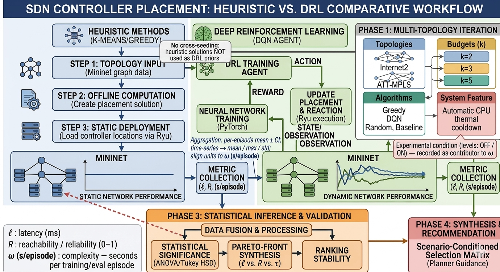
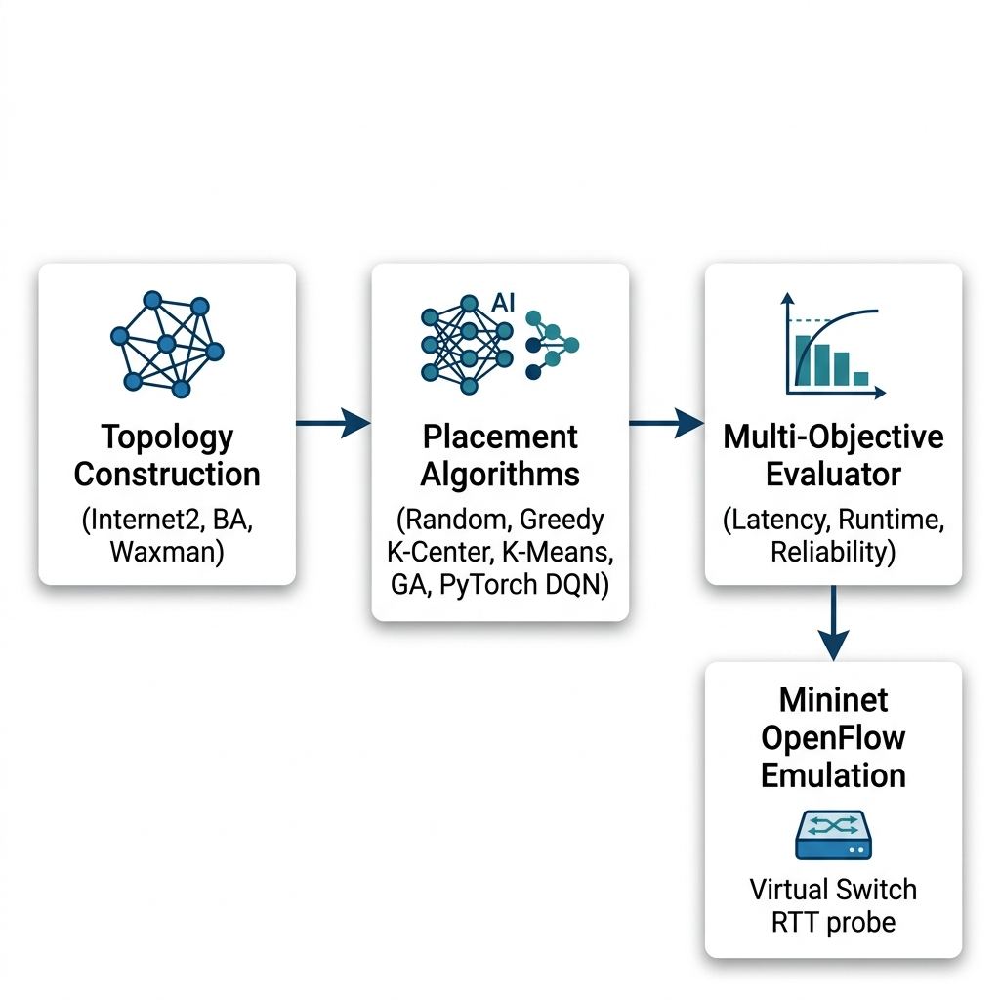

# CHAPTER THREE

# 3.0 METHODOLOGY/DESIGN AND IMPLEMENTATION

## 3.1 RESEARCH DESIGN

This study employs a deductive, quantitative experimental benchmarking design rooted in empirical computer science and multi-objective combinatorial optimization. Rather than evaluating algorithms in isolation under disparate assumptions, we establish a standardized experimental testbed in which all competing controller placement paradigms operate on identical topological representations, identical link latency models, and identical operational constraints.

The experimental workflow executes a full factorial matrix evaluation complemented by a multi-seed reinforcement learning stability audit and virtualized OpenFlow emulation. Figure 3.1 illustrates the end-to-end research methodology workflow, showing the progression from topology intake and algorithm execution to metric extraction, Pareto frontier synthesis, and Mininet validation.

**Figure 3.1: End-to-End Comparative Research Methodology Workflow.**

The investigation tests two formal hypotheses:

- Null Hypothesis ($H_{01}$): In multi-site SDN topologies ($N \le 50$), Deep Reinforcement Learning algorithms do not provide a statistically significant improvement in multi-objective decision quality (joint propagation latency, single-link failure reachability, and computational runtime) compared to classical heuristics.
- Alternative Hypothesis ($H_{11}$): Deep Reinforcement Learning models achieve competitive propagation latency and fault tolerance, but incur a quantifiable computational training overhead ($\omega$) that leaves them Pareto-dominated by classical clustering and greedy heuristics in static network environments.

## 3.2 DATA COLLECTION & NETWORK TOPOLOGY CORPUS

To evaluate algorithmic behavior across realistic wide-area backbones and controlled topological structures, the experimental corpus combines canonical empirical topologies with parameterized synthetic network models. Table 3.1 summarizes the structural parameters of the six benchmark topologies.

**Table 3.1: Summary of Canonical and Synthetic Network Topology Parameters**

| Topology Name | Topology Family | Node Count ($N$) | Edge Count ($M$) | Mean Node Degree | Clustering Coefficient | Characteristic Graph Property |
| :--- | :--- | :---: | :---: | :---: | :---: | :--- |
| Internet2 (GraphML / Core) | Canonical WAN | 20 (11 Core) | 26 (18 Core) | 2.60 (3.27) | 0.250 (0.333) | Sparse national US research backbone (`Internet2.graphml` / 11-PoP core) |
| ATT-MPLS | Canonical WAN | 21 | 54 | 5.14 | 0.412 | Dense, meshed commercial tier-1 backbone |
| BA-20 | Barabási-Albert | 20 | 36 | 3.60 | 0.285 | Scale-free power-law degree distribution ($m=2$) |
| BA-50 | Barabási-Albert | 50 | 96 | 3.84 | 0.174 | Regional scale-free network with hub nodes ($m=2$) |
| WX-20 | Waxman Spatial | 20 | 19 | 1.90 | 0.050 | Geographically constrained sparse mesh ($\alpha=0.4, \beta=0.1$) |
| WX-50 | Waxman Spatial | 50 | 53 | 2.12 | 0.042 | Planar geographic network with sparse long links ($\alpha=0.4, \beta=0.1$) |

### 3.2.1 Canonical Empirical Topologies
First, the Internet2 backbone serves as the standard reference topology in SDN controller placement literature (Mohanty et al., 2021; Yusuf et al., 2023; Farahi et al., 2026). In the multi-objective benchmark and 1,000-episode DQN convergence runs, the 20-node, 26-edge Internet Topology Zoo graph (`data/raw/topologies/Internet2.graphml`) is evaluated; in the Phase 4 Mininet kernel overhead gate test (`scripts/test_mininet_overhead.py`), the 11-switch, 18-edge core PoP configuration is instantiated to measure per-switch Open vSwitch setup and teardown latency. Second, the ATT-MPLS topology models a 21-node, 54-link commercial multi-protocol label switching core network with high path redundancy (Xiao & Chen, 2021; Benoudifa et al., 2023).

### 3.2.2 Parameterized Synthetic Network Models
To isolate the structural drivers governing algorithm performance, synthetic graphs were generated using two graph-theoretic models implemented in NetworkX (Vardhan & SriBhargav, 2025; Boudi, 2026):

1. Barabási-Albert (BA) Scale-Free Model: Generates networks via preferential attachment in which new nodes connect to existing nodes with probability proportional to their degree ($P(k) \sim k^{-\gamma}$). Parameterized with attachment factor $m = 2$ at scales $N = 20$ and $N = 50$, this produces a skewed degree distribution with central transit hubs and peripheral leaves.
2. Waxman Spatial Random Graph Model: Generates geographically embedded networks (Vardhan & SriBhargav, 2025; Boudi, 2026) in which nodes are placed uniformly at random on the unit square $[0, 1]^2$. The probability $P(u, v)$ of placing an edge between nodes $u$ and $v$ decays exponentially with Euclidean distance $d(u, v)$:
   $$P(u, v) = \alpha \cdot \exp\left( - \frac{d(u, v)}{\beta \cdot L} \right)$$
   where $L$ is the maximum inter-node Euclidean distance, $\alpha = 0.4$ controls link density, and $\beta = 0.1$ governs the ratio of short to long edges.

### 3.2.3 Data Provenance and Ethical Considerations
All topological data used in this study are either generated synthetically or loaded from public scientific datasets (Internet Topology Zoo). No proprietary telecommunications records, personally identifiable information (PII), or private enterprise packet traces were collected, ensuring compliance with University of Zululand research ethics requirements.

## 3.3 SYSTEM DESIGN & ALGORITHMIC FORMULATIONS

Given an undirected connected graph $G = (V, E)$ with $N$ switches and $M$ physical links, let $d(u, v)$ denote the shortest-path propagation distance between nodes $u$ and $v$ computed via Dijkstra's algorithm over edge weights. Let $P \subseteq V$ denote the set of $k$ selected controller locations.

### 3.3.1 Algorithm 1: Random Baseline Placement
The Random baseline samples $k$ distinct switch nodes uniformly at random from $V$ without replacement using a seeded pseudo-random number generator:
$$P_{rand} \sim \text{Uniform}(V, k)$$
This establishes the unoptimized reference baseline against which heuristic and learning-based methods are compared.

### 3.3.2 Algorithm 2: Greedy $K$-Center Placement (Farthest-First Traversal)
Implements deterministic farthest-first 2-approximation traversal for the $k$-center problem (`algorithms/baseline/greedy_placement.py`, Mohanty et al., 2021; Vardhan & SriBhargav, 2025):

1. Initialize $P = \{ v_0 \}$ at the graph eccentricity center.
2. For $i = 2$ to $k$, select the switch that maximizes the minimum distance to the already chosen controllers:
   $$c_i = \arg\max_{v \in V - P} \left( \min_{c \in P} d(v, c) \right), \quad P \leftarrow P \cup \{ c_i \}$$

3. Return $P$ after $k$ iterations in $\mathcal{O}(kN)$ matrix lookups.

### 3.3.3 Algorithm 3: Spatial $K$-Means Clustering
Partitions network switches into $k$ clusters in coordinate space (`algorithms/baseline/kmeans_placement.py`, Xiao & Chen, 2021; Priya et al., 2025):

1. Node coordinates $(x_i, y_i)$ are extracted from the graph layout or shortest-path distance profile.
2. Centroids are initialized via $K$-Means++ and refined iteratively until convergence (tolerance $10^{-4}$ or $T = 300$ iterations).
3. For each final cluster centroid $\mu_j$, the closest discrete switch node is selected as the controller host:
   $$c_j = \arg\min_{v \in V} d_2(\mathbf{x}_v, \mu_j)$$

### 3.3.4 Algorithm 4: Genetic Algorithm (GA Metaheuristic)
Operates on a discrete combinatorial chromosome representation (`algorithms/ai/genetic_algorithm.py`, Radam et al., 2022; Xu et al., 2023; Boudi, 2026):

- Encoding: Each chromosome is a $k$-element subset $\mathbf{g} = [g_1, g_2, \dots, g_k]$ of distinct switch nodes ($g_i \in V$).
- Population and Generations: Evolves a population of $M_{pop} = 40$ to $50$ candidate placements over $G_{max} = 30$ to $50$ generations.
- Fitness Function: Evaluates inverse average propagation latency with optional weighting for worst-case tail delay ($w_{\max}$) and single-link reliability ($w_{\text{rel}}$, with $w_{\max} = 0, w_{\text{rel}} = 0$ in the baseline latency sweep):
  $$\text{Fitness}(\mathbf{g}) = -\left( L(P_{\mathbf{g}}) + w_{\max} \cdot L_{\max}(P_{\mathbf{g}}) \right) + w_{\text{rel}} \cdot Reach_{avg}(P_{\mathbf{g}})$$

- Operators: Binary tournament selection, cardinality-preserving uniform crossover, swap mutation with probability $p_m = 0.15$, and elitism preserving the top 2 individuals per generation.

### 3.3.5 Algorithm 5: PyTorch Deep $Q$-Network (DQN) and Multi-Armed RL
The reinforcement learning placement pipeline (`scripts/train_dqn_pilot.py`, `scripts/run_stability_audit.py`, and `algorithms/ai/reinforcement_learning.py`) follows the hyperparameter specification of Farahi et al. (2026). The neural network (`DQNetwork`) is a three-layer Multi-Layer Perceptron (MLP) taking an $N$-dimensional state vector as input (`nn.Linear(N, 64)`), passing through two hidden layers of 64 units each with ReLU activations (`nn.Linear(64, 64)`), and outputting $N$ action $Q$-values (`nn.Linear(64, N)`).

During training, transitions $(s_t, a_t, r_t, s_{t+1}, d_t)$ are stored in a cyclic replay buffer of capacity $M = 10,000$ and sampled in mini-batches of size $32$. A separate target network is synchronized periodically to stabilize temporal-difference targets. In `dqn_controller_placement`, the neural agent optimizes a normalized latency-and-reliability reward ($10 \cdot (L_{\max} - L(P))/L_{\max} + 5 \cdot Reach_{avg}(P)$), while the $\epsilon$-greedy tabular multi-armed RL solver (`bandit_rl_controller_placement`, 200 to 300 episodes per seed over 64 candidate $k$-tuples) applies the configurable `rl_objective` weights (`latency_weight`, `reliability_weight`, and `seconds_per_episode_weight` from `configs/experiment_config.json`) across all 60 cells of the multi-seed factorial sweep so that both offline training time ($\omega_{\text{train}}$) and single forward-pass inference time ($\tau_{\text{inf}}$) are measured across all graph scales. Table 3.2 summarizes the DQN hyperparameter configuration.

**Table 3.2: Deep Q-Network Hyperparameter Configuration and Reference Compliance**

| Hyperparameter | Configured Value | Reference / Purpose |
| :--- | :--- | :--- |
| Neural Network Architecture | MLP: Input($N$) $\to$ 64 $\to$ 64 $\to$ Output($N$) | Farahi et al. (2026) architecture |
| Hidden Activation | Rectified Linear Unit (ReLU) | Non-linear feature projection |
| Optimizer | Adam ($\beta_1 = 0.9, \beta_2 = 0.999$) | Adaptive gradient descent |
| Learning Rate ($\alpha$) | 0.001 ($10^{-3}$) | Farahi et al. (2026) baseline |
| Discount Factor ($\gamma$) | 0.99 | Long-horizon return weighting |
| Mini-Batch Size | 32 | Replay buffer batch size |
| Replay Memory Capacity ($M$) | 10,000 transitions | Breaks temporal sample correlation |
| Exploration Schedule | $\epsilon$-Greedy: $1.0 \to 0.05$ ($\lambda = 0.995$) | Exponential exploration decay |
| Target Network Sync | Every 100 steps (or Polyak $\tau = 0.005$) | Stabilizes $Q$-target updates |
| Episode Budget | 1,000 episodes (pilot & stability audit) | Full policy convergence horizon |

## 3.4 IMPLEMENTATION ARCHITECTURE & EMULATION HARNESS

### 3.4.1 Software Engineering Stack
The experimental harness is implemented in Python 3.12 (`ai-sdn-controller-placement`). Graph generation, shortest-path Dijkstra computation, and biconnected component analysis are implemented with NetworkX. Neural network training and forward-pass inference timing use CPU-compiled PyTorch (`torch.nn`, `torch.optim`). Clustering and statistical testing use Scikit-Learn, NumPy, and Pandas. Figure 3.2 illustrates the software and emulation system architecture.

**Figure 3.2: System Architecture of the Multi-Objective Controller Placement Benchmark and Mininet Emulation Harness.**

### 3.4.2 Mininet OpenFlow Emulation Architecture
To evaluate how shortest-path graph latencies compare with packet-switched control-plane delays, controller placements on Internet2 are evaluated in a virtualized Linux emulation harness (`simulation/mininet_simulation.py` and `scripts/test_mininet_overhead.py`) built on Mininet 2.3+ and Open vSwitch (OVS). In the emulation topology, each graph node is instantiated as an OpenFlow switch connected via virtual Ethernet (`veth`) links configured with edge-weighted `TCLink` propagation delays $d_{\text{tc}}(u, v) = \max(0.10\text{ ms}, 2.0 \times w(u, v))$ (scaling geodesic edge weight $w(u, v)$ by $2.0\times$ with a $0.10\text{ ms}$ host-switch access delay and $\pm 0.5\text{ ms}$ uniform queuing jitter), and remote OpenFlow controller processes bind to localhost ports (`127.0.0.1:6633+`). Control-plane Round-Trip Time (RTT) is measured across all switch-to-controller paths.

### 3.4.3 The Phase 4 Mininet "2-Second Gate Test" Protocol
Running live Mininet network creation and teardown inside every episode of an online reinforcement learning loop introduces operating system namespace overhead. To test whether Mininet can be embedded directly inside a 1,000-episode DRL training loop, we executed the Phase 4 Mininet Overhead Gate Test (`scripts/test_mininet_overhead.py`, archived in `results/mininet_overhead_validation.json`). Across 3 independent trials on the 11-node, 18-edge Internet2 topology ($k=3$), each trial was timed across four phases:

1. Phase A (Topology Instantiation): Pre-cleaning lingering interfaces and constructing switches, hosts, and virtual links.
2. Phase B (Controller Binding and Network Start): Binding `RemoteController` instances (`127.0.0.1:6633+`) and starting OVS bridges.
3. Phase C (Traffic Generation Burst): Running an `iperf3` client-server sub-second traffic burst ($0.2\text{ s}$) between hosts.
4. Phase D (Cleanup and Teardown): Stopping Mininet (`net.stop()`) and clearing OVS bridges (`mn -c`).

A decision threshold of $2,000\text{ ms}$ per episode was set prior to experimentation: if the full lifecycle overhead (Phases A + B + C + D) exceeds $2,000\text{ ms}$, online Mininet-in-the-loop training is deferred in favor of fast graph-based training followed by post-convergence Mininet validation. As recorded in `results/mininet_overhead_validation.json`, all 3 trials exceeded the $2,000\text{ ms}$ threshold (averaging $2,875.49\text{ ms}$ full lifecycle due to a $1,985.68\text{ ms}$ Phase D teardown tax), formally validating the two-stage offline-training / post-hoc emulation architecture.

## 3.5 DATA ANALYSIS & EVALUATION METRICS

### 3.5.1 Average Switch-to-Controller Propagation Latency ($L(P)$)
Measures the mean shortest-path propagation delay from every switch $v \in V$ to its nearest assigned controller $c \in P$ (`evaluation/metrics.py`):
$$L(P) = \frac{1}{N} \sum_{v \in V} \min_{c \in P} d(v, c)$$

### 3.5.2 Control-Plane Reliability ($Reach_{avg}$) Under Single-Link Failure ($N-1$ Engine)
Quantifies structural control-plane survivability under single physical link cuts (`control_plane_reliability_single_link_failure_cached` in `evaluation/metrics.py`). For each edge $e \in E$, $e$ is removed to form the residual graph $G_e = (V, E - e)$, which decomposes into connected components $\mathcal{K}(G_e)$. A switch $v \in V$ remains controller-reachable under link failure $e$ if and only if its connected component in $G_e$ contains at least one controller $c \in P$:
$$\mathbb{I}_{reach}(v, G_e, P) = \begin{cases} 1, & \text{if } \exists c \in P \text{ such that } d_{G_e}(v, c) < \infty \\ 0, & \text{otherwise} \end{cases}$$
The expected single-link survivability across all $M$ link-failure states is:
$$Reach_{avg}(P) = \frac{1}{M \cdot N} \sum_{e \in E} \sum_{v \in V} \mathbb{I}_{reach}(v, G_e, P)$$
where $Reach_{avg}(P) \in [0.0, 1.0]$. In 2-edge-connected (biconnected) graphs such as Internet2 ($N=20, M=26$), ATT-MPLS ($N=21, M=54$), and Barabási-Albert ($m=2$), removing any single edge never partitions the graph, yielding $Reach_{avg}(P) = 1.0$ ($100\%$). In sparse Waxman graphs containing bridge edges or degree-1 leaf nodes, removing a bridge edge isolates any component lacking a controller, reducing $Reach_{avg}(P)$ below $1.0$.

### 3.5.3 Computational Complexity Tax ($\omega_{\text{train}}$) and Online Inference Latency ($\tau_{\text{inf}}$)
To avoid conflating offline model preparation with online decision speed, computational cost is decomposed into two distinct metrics:

1. Offline Training Overhead ($\omega_{\text{train}}$): The wall-clock CPU time (in seconds or milliseconds, and per-episode rate $\omega$ in $\text{s/episode}$) required to train the RL policy prior to deployment. Single-shot heuristics require zero offline training ($\omega_{\text{train}} = 0$).
2. Online Execution / Forward-Pass Inference Latency ($\tau_{\text{inf}}$): The wall-clock CPU time (in milliseconds) required to compute a placement directly (for Random, Greedy $K$-Center, $K$-Means, and GA) or to execute a single greedy forward pass ($\epsilon = 0$) through a trained PyTorch `DQNetwork`.

### 3.5.4 Three-Dimensional Pareto Dominance & Compromise Distance
A placement $P_1$ Pareto-dominates $P_2$ ($P_1 \succ P_2$) if $L(P_1) \le L(P_2)$, $Reach_{avg}(P_1) \ge Reach_{avg}(P_2)$, and $\omega(P_1) \le \omega(P_2)$, with strict inequality in at least one objective (`evaluation/pareto.py`). Non-dominated solutions are ranked by their normalized Euclidean distance $D_{ideal}(P)$ to the empirical ideal point $\mathbf{z}_{ideal} = (L_{\min}, Reach_{\max}, \omega_{\min})$:
$$D_{ideal}(P) = \sqrt{ w_1 \left( \frac{L(P) - L_{\min}}{L_{\max} - L_{\min}} \right)^2 + w_2 \left( \frac{Reach_{\max} - Reach_{avg}(P)}{Reach_{\max} - Reach_{\min}} \right)^2 + w_3 \left( \frac{\omega(P) - \omega_{\min}}{\omega_{\max} - \omega_{\min}} \right)^2 }$$
with priority weights $w_1 = 0.5$, $w_2 = 0.3$, and $w_3 = 0.2$.

### 3.5.5 Statistical Hypothesis Testing & Experimental Design Degrees of Freedom
To test whether latency differences across algorithms are statistically significant, Multi-Factor Analysis of Variance (ANOVA) is performed on the synthetic factorial dataset (`results/experiment_data/factorial_latency_cost_raw_20261017_052319.csv`, $N_{obs} = 300$). The balanced fixed-effects design comprises 60 factorial cells across four factors:

1. Algorithm Family: 5 levels (Random, Greedy $K$-Center, $K$-Means, GA, PyTorch DQN / Bandit RL; $df_{alg} = 4$).
2. Topology Family: 2 levels (Barabási-Albert and Waxman; $df_{topo} = 1$).
3. Node Scale ($N$): 2 levels ($N \in \{20, 50\}$; $df_{scale} = 1$).
4. Controller Budget ($k$): 3 levels ($k \in \{2, 3, 5\}$; $df_k = 2$).

Each of the $60$ cells ($5 \times 2 \times 2 \times 3 = 60$) is replicated across $n = 5$ independent trial seeds (`seeds = [42, 43, 44, 45, 46]`), yielding $N_{obs} = 60 \times 5 = 300$ total observations ($df_{total} = 299$) and a within-cell residual error degrees of freedom of $df_{error} = 60 \times (5 - 1) = 240$. (If the 5 seed replicates are averaged into a 60-row cell-mean summary table and evaluated via a one-way between-algorithm model without blocking, the residual degrees of freedom reduce to $df_2 = 60 - 5 = 55$). Post-hoc pairwise comparisons use Tukey's Honest Significant Difference (HSD) test at $\alpha = 0.05$ and Cohen's $d$ standardized effect sizes.

## 3.6 EXPERIMENTAL SETUP & VERIFICATION CONTROLS

All benchmark experiments were executed on a Linux workstation (Ubuntu x86_64, Python 3.12 virtual environment). Reproducibility was enforced through three software controls:

1. Deterministic Seed Control: All pseudo-random generators (`random`, `numpy.random`, and `torch.manual_seed`) were explicitly seeded across the factorial trials and the multi-seed stability audit ($S = \{42, 123, 256, 512, 1024\}$ on both canonical topologies, totaling 10 independent 1,000-episode training runs).
2. Precomputed Reliability Caching: To eliminate redundant graph copying during multi-episode evaluations, single-link failure component labels are precomputed and verified via `assert_cache_parity` (`evaluation/metrics.py`) to match exact Dijkstra edge-removal reachability within $10^{-9}$.
3. Automated Unit Test Suite: The repository includes 22 automated `unittest` verification tests (`tests/`) covering configuration merging, manifest schemas, Pareto dominance, reliability parity, RL JSONL logging, PyTorch DQN training/inference timing, and GraphML/GML topology parsing.

Table 3.3 summarizes the 60-cell synthetic factorial experimental matrix.

**Table 3.3: Full Factorial Benchmark Design Matrix ($2 \times 2 \times 3 \times 5 = 60$ Cells)**

| Factor | Factor Levels | Levels | Description |
| :--- | :--- | :---: | :--- |
| Topology Model | Barabási-Albert (BA), Waxman (WX) | 2 | Scale-free degree skew vs. spatial planar clustering |
| Node Scale ($N$) | $N = 20, N = 50$ | 2 | Small enterprise vs. regional wide-area network |
| Controller Budget ($k$) | $k = 2, k = 3, k = 5$ | 3 | Minimal redundancy, standard budget, high redundancy |
| Algorithm Family | Random, Greedy $K$-Center, $K$-Means, GA, DQN/RL | 5 | Baseline, heuristics, metaheuristic, reinforcement learning |
| Total Factorial Cells | $2 \times 2 \times 3 \times 5$ | 60 Cells | 5 seed trials per cell ($N_{obs} = 300$ total runs) |
