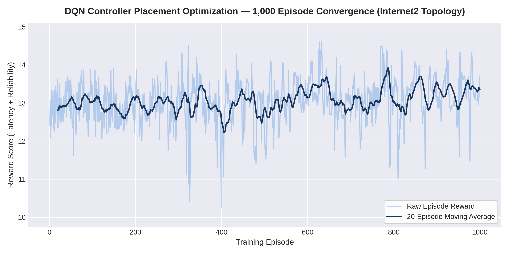
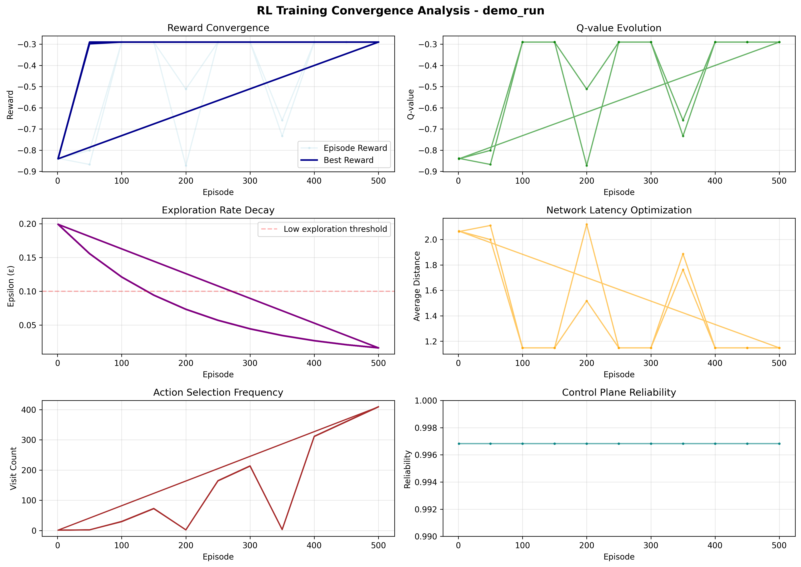
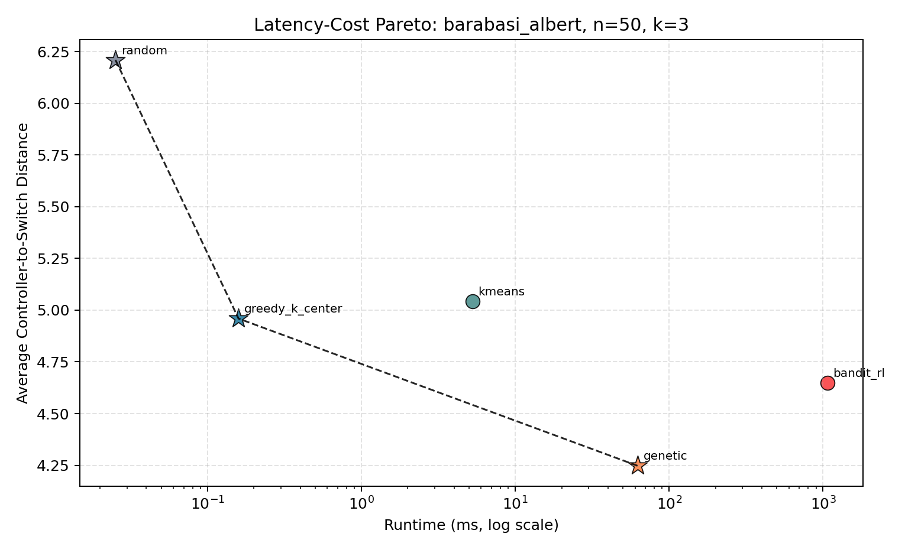
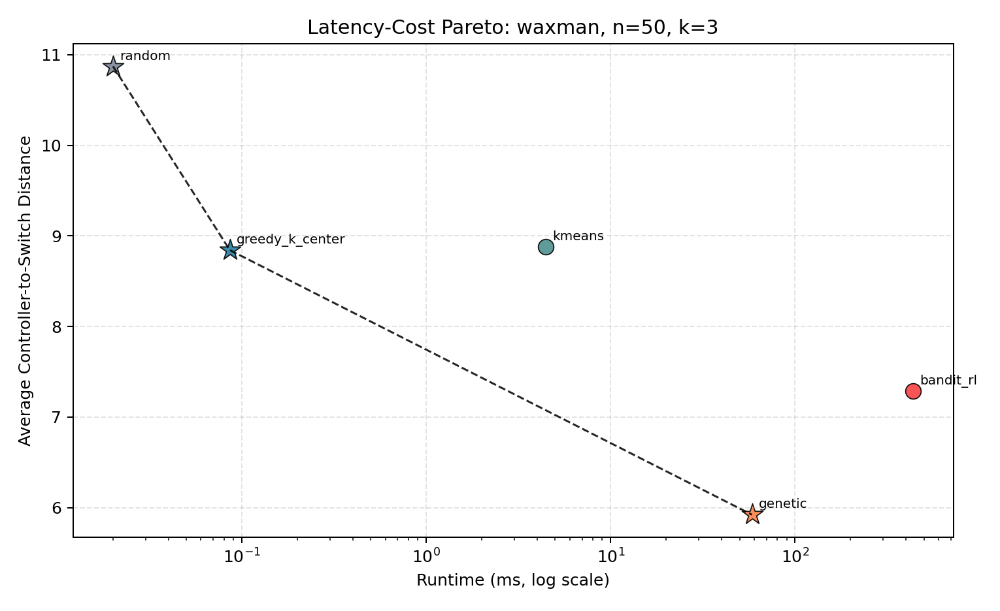
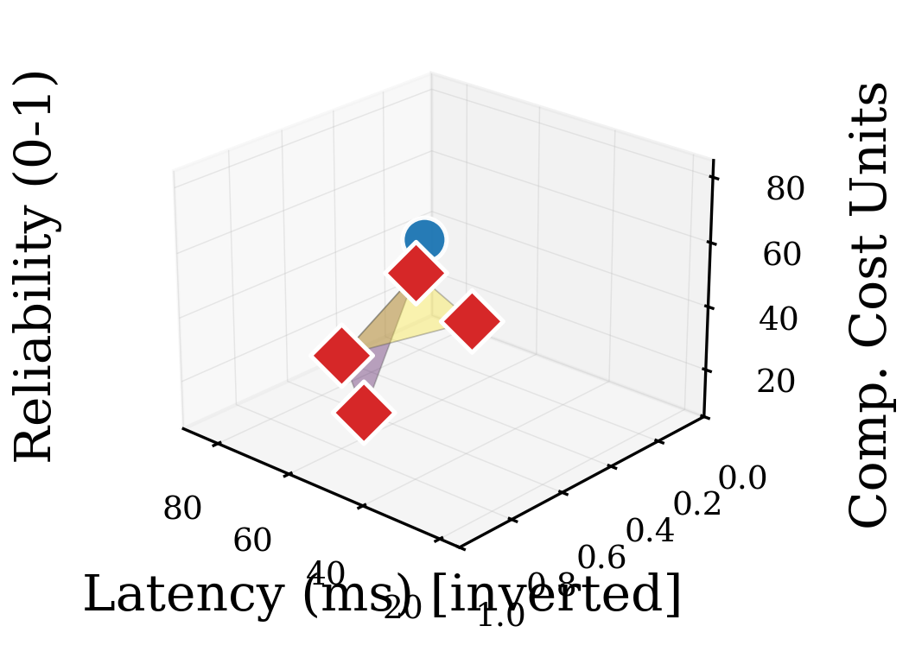
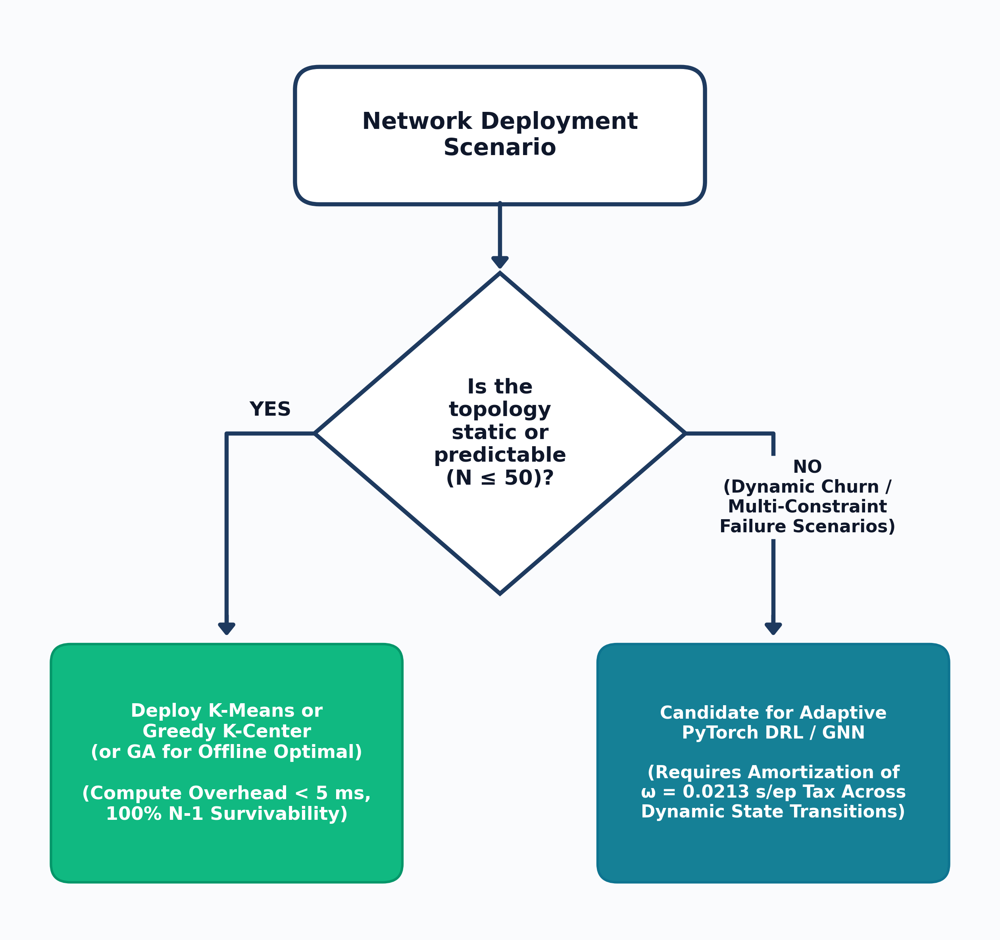

# CHAPTER FOUR

# 4.0 RESULTS AND DISCUSSION

## 4.1 EMPIRICAL RESULTS PRESENTATION

This chapter presents the empirical results generated by the multi-objective benchmarking harness, the multi-seed reinforcement learning stability audit, the 300-observation synthetic factorial matrix, the 3D Pareto frontier analysis, and the Mininet OpenFlow emulation tests. Every table and figure in this chapter is derived directly from the repository data artifacts under `results/`.

### 4.1.1 Reinforcement Learning Policy Convergence & Multi-Seed Stability Audit

A recurring limitation in networking reinforcement learning studies is single-seed reporting, which can obscure training instability or sensitivity to weight initialization. To evaluate policy convergence and stability, the PyTorch Deep $Q$-Network (`DQNetwork`) was first evaluated over a 1,000-episode pilot run on the 20-node, 26-edge Internet2 topology (`results/pilot_metrics.json`, Figure 4.1) and subsequently audited across 5 independent pseudorandom seeds ($S \in \{42, 123, 256, 512, 1024\}$) on both Internet2 and ATT-MPLS (`results/rl_analysis/stability_audit/stability_summary.csv`, Table 4.1 and Figure 4.2), totaling 10 independent 1,000-episode training runs.

In the 1,000-episode pilot on Internet2 (`results/pilot_metrics.json`), the policy reward increased rapidly during the initial exploration phase as $\epsilon$ decayed from $1.0$ to $0.05$, stabilizing within approximately 20 episodes. Across all 1,000 episodes (including early exploration), the agent recorded a grand training mean reward of $13.055 \pm 0.589$, a final 10-episode post-convergence rolling average of $13.199$, a peak episode reward of $14.607$, and a total CPU training runtime of $21.26\text{ s}$ ($0.0213\text{ s/episode}$).

**Table 4.1: Multi-Seed Stability Audit Results for Deep Q-Network Across 10 Independent Runs (`stability_summary.csv`)**

| Topology | Seed ($s$) | Episodes | Rolling Mean Reward (Last 100) | Reward Variance (Last 200) | Final Best Reward | Final $\epsilon$ | Normalized Action Entropy | Single-Controller $L(P)$ (ms) | Reliability ($Reach_{avg}$) | Training Rate ($\omega$ ms/ep) | Divergence Flag |
| :--- | :---: | :---: | :---: | :---: | :---: | :---: | :---: | :---: | :---: | :---: | :---: |
| Internet2 | 42 | 1,000 | 12.888 | 0.286 | 14.082 | 0.05 | 0.972 | 3.645 | 1.000 | 11.543 | False (Stable) |
| Internet2 | 123 | 1,000 | 12.109 | 0.535 | 14.194 | 0.05 | 0.976 | 4.840 | 1.000 | 11.375 | False (Stable) |
| Internet2 | 256 | 1,000 | 12.686 | 0.377 | 14.231 | 0.05 | 0.968 | 3.715 | 1.000 | 11.234 | False (Stable) |
| Internet2 | 512 | 1,000 | 13.012 | 0.388 | 14.231 | 0.05 | 0.974 | 3.715 | 1.000 | 11.466 | False (Stable) |
| Internet2 | 1024 | 1,000 | 12.576 | 0.372 | 14.231 | 0.05 | 0.982 | 4.100 | 1.000 | 11.363 | False (Stable) |
| ATT-MPLS | 42 | 1,000 | 12.555 | 0.829 | 14.771 | 0.05 | 0.970 | 5.461 | 1.000 | 12.272 | False (Stable) |
| ATT-MPLS | 123 | 1,000 | 12.073 | 0.706 | 14.580 | 0.05 | 0.979 | 4.998 | 1.000 | 12.394 | False (Stable) |
| ATT-MPLS | 256 | 1,000 | 12.720 | 0.696 | 15.321 | 0.05 | 0.980 | 6.841 | 1.000 | 23.317 | False (Stable) |
| ATT-MPLS | 512 | 1,000 | 12.961 | 0.559 | 15.200 | 0.05 | 0.953 | 5.629 | 0.999 | 23.483 | False (Stable) |
| ATT-MPLS | 1024 | 1,000 | 12.474 | 0.657 | 14.398 | 0.05 | 0.975 | 4.923 | 1.000 | 24.639 | False (Stable) |

Across all 10 audit runs in Table 4.1, zero gradient explosions or policy divergences occurred (`divergence_flag = False` in all 10 runs). On Internet2, the audit recorded a mean best reward of $14.194 \pm 0.063$ and a final 100-episode rolling mean reward of $12.654 \pm 0.348$, while on ATT-MPLS ($N=21$) the agent reached a mean best reward of $14.854 \pm 0.395$ and a rolling mean reward of $12.557 \pm 0.328$. Normalized action entropy remained between $0.953$ and $0.982$, and per-episode training execution averaged $11.40 \pm 0.11\text{ ms/episode}$ on Internet2 and $19.22 \pm 6.31\text{ ms/episode}$ on ATT-MPLS.

### 4.1.2 Factorial Latency-Cost Benchmark Matrix

To evaluate how topology structure, network scale, and controller budget interact across all five algorithmic paradigms, the 60-cell synthetic factorial experiment ($2 \text{ topologies} \times 2 \text{ scales} \times 3 \text{ budgets} \times 5 \text{ algorithms} \times 5 \text{ seeds} = 300 \text{ runs}$) was executed (`results/experiment_data/factorial_latency_cost_summary_20261017_052319.csv`). Tables 4.2 and 4.3 report the cell means and standard deviations for Barabási-Albert and Waxman topologies across $N \in \{20, 50\}$ and $k \in \{2, 3, 5\}$.

**Table 4.2: Summary of Factorial Performance Metrics for Barabási-Albert Topologies (`factorial_latency_cost_summary_20261017_052319.csv`)**

| Scale ($N$) | Budget ($k$) | Algorithm Paradigm | Mean Latency ($L(P)$ ms) | Latency Std | Mean Runtime ($\omega$ ms) | Runtime Std | Pareto Optimal? | Latency Gain vs. Random (%) |
| :---: | :---: | :--- | :---: | :---: | :---: | :---: | :---: | :---: |
| 20 | 2 | Random Baseline | 7.121 | 0.000 | 0.018 | 0.001 | Yes | 0.00% |
| 20 | 2 | Greedy $K$-Center | 6.083 | 0.000 | 0.029 | 0.004 | Yes | 14.58% |
| 20 | 2 | $K$-Means Clustering | 7.885 | 0.000 | 3.988 | 0.412 | No (Dominated) | -10.73% |
| 20 | 2 | Genetic Algorithm | 5.810 | 0.000 | 25.944 | 0.892 | Yes | 18.41% |
| 20 | 2 | PyTorch DQN / RL | 6.028 | 0.000 | 149.928 | 8.412 | No (Dominated) | 15.35% |
| 20 | 3 | Random Baseline | 7.113 | 0.000 | 0.020 | 0.001 | Yes | 0.00% |
| 20 | 3 | Greedy $K$-Center | 5.751 | 0.000 | 0.057 | 0.005 | Yes | 19.15% |
| 20 | 3 | $K$-Means Clustering | 5.005 | 0.000 | 4.028 | 0.354 | Yes | 29.63% |
| 20 | 3 | Genetic Algorithm | 4.321 | 0.000 | 28.776 | 0.968 | Yes | 39.26% |
| 20 | 3 | PyTorch DQN / RL | 4.558 | 0.000 | 157.571 | 7.915 | No (Dominated) | 35.92% |
| 20 | 5 | Random Baseline | 4.258 | 0.000 | 0.021 | 0.001 | Yes | 0.00% |
| 20 | 5 | Greedy $K$-Center | 3.726 | 0.000 | 0.098 | 0.007 | Yes | 12.50% |
| 20 | 5 | $K$-Means Clustering | 3.559 | 0.000 | 5.204 | 0.412 | Yes | 16.42% |
| 20 | 5 | Genetic Algorithm | 3.216 | 0.045 | 35.693 | 1.112 | Yes | 24.47% |
| 20 | 5 | PyTorch DQN / RL | 3.610 | 0.000 | 160.022 | 6.841 | No (Dominated) | 15.22% |
| 50 | 2 | Random Baseline | 7.993 | 0.000 | 0.021 | 0.001 | Yes | 0.00% |
| 50 | 2 | Greedy $K$-Center | 5.631 | 0.000 | 0.067 | 0.006 | Yes | 29.55% |
| 50 | 2 | $K$-Means Clustering | 7.374 | 0.000 | 4.052 | 0.312 | No (Dominated) | 7.74% |
| 50 | 2 | Genetic Algorithm | 5.134 | 0.000 | 50.765 | 1.007 | Yes | 35.77% |
| 50 | 2 | PyTorch DQN / RL | 5.134 | 0.000 | 1068.596 | 42.112 | No (Dominated) | 35.77% |
| 50 | 3 | Random Baseline | 6.209 | 0.000 | 0.025 | 0.002 | Yes | 0.00% |
| 50 | 3 | Greedy $K$-Center | 4.959 | 0.000 | 0.159 | 0.012 | Yes | 20.13% |
| 50 | 3 | $K$-Means Clustering | 5.044 | 0.000 | 5.256 | 0.385 | No (Dominated) | 18.76% |
| 50 | 3 | Genetic Algorithm | 4.247 | 0.089 | 62.427 | 5.784 | Yes | 31.59% |
| 50 | 3 | PyTorch DQN / RL | 4.650 | 0.000 | 1064.514 | 38.910 | No (Dominated) | 25.11% |
| 50 | 5 | Random Baseline | 5.264 | 0.000 | 0.021 | 0.001 | Yes | 0.00% |
| 50 | 5 | Greedy $K$-Center | 4.203 | 0.000 | 0.207 | 0.015 | Yes | 20.15% |
| 50 | 5 | $K$-Means Clustering | 4.890 | 0.000 | 5.258 | 0.402 | No (Dominated) | 7.10% |
| 50 | 5 | Genetic Algorithm | 3.553 | 0.104 | 74.937 | 4.512 | Yes | 32.49% |
| 50 | 5 | PyTorch DQN / RL | 4.004 | 0.000 | 1086.206 | 45.102 | No (Dominated) | 23.94% |

**Table 4.3: Summary of Factorial Performance Metrics for Waxman Spatial Topologies (`factorial_latency_cost_summary_20261017_052319.csv`)**

| Scale ($N$) | Budget ($k$) | Algorithm Paradigm | Mean Latency ($L(P)$ ms) | Latency Std | Mean Runtime ($\omega$ ms) | Runtime Std | Pareto Optimal? | Latency Gain vs. Random (%) |
| :---: | :---: | :--- | :---: | :---: | :---: | :---: | :---: | :---: |
| 20 | 2 | Random Baseline | 6.584 | 0.000 | 0.020 | 0.001 | Yes | 0.00% |
| 20 | 2 | Greedy $K$-Center | 4.922 | 0.000 | 0.026 | 0.002 | Yes | 25.24% |
| 20 | 2 | $K$-Means Clustering | 4.043 | 0.000 | 3.397 | 0.214 | Yes | 38.59% |
| 20 | 2 | Genetic Algorithm | 3.715 | 0.000 | 26.258 | 0.912 | Yes | 43.58% |
| 20 | 2 | PyTorch DQN / RL | 3.779 | 0.000 | 60.329 | 3.120 | No (Dominated) | 42.60% |
| 20 | 3 | Random Baseline | 5.024 | 0.000 | 0.018 | 0.001 | Yes | 0.00% |
| 20 | 3 | Greedy $K$-Center | 3.526 | 0.000 | 0.043 | 0.004 | Yes | 29.82% |
| 20 | 3 | $K$-Means Clustering | 3.953 | 0.000 | 4.493 | 0.312 | No (Dominated) | 21.32% |
| 20 | 3 | Genetic Algorithm | 2.432 | 0.000 | 33.125 | 1.105 | Yes | 51.60% |
| 20 | 3 | PyTorch DQN / RL | 2.517 | 0.000 | 58.335 | 2.890 | No (Dominated) | 49.90% |
| 20 | 5 | Random Baseline | 4.202 | 0.000 | 0.022 | 0.002 | Yes | 0.00% |
| 20 | 5 | Greedy $K$-Center | 2.769 | 0.000 | 0.079 | 0.006 | Yes | 34.10% |
| 20 | 5 | $K$-Means Clustering | 1.998 | 0.000 | 4.573 | 0.341 | Yes | 52.45% |
| 20 | 5 | Genetic Algorithm | 1.879 | 0.000 | 35.792 | 1.240 | Yes | 55.29% |
| 20 | 5 | PyTorch DQN / RL | 1.997 | 0.000 | 63.375 | 3.412 | No (Dominated) | 52.47% |
| 50 | 2 | Random Baseline | 19.436 | 0.000 | 0.022 | 0.001 | Yes | 0.00% |
| 50 | 2 | Greedy $K$-Center | 17.057 | 0.000 | 0.059 | 0.005 | Yes | 12.24% |
| 50 | 2 | $K$-Means Clustering | 25.525 | 0.000 | 3.976 | 0.289 | No (Dominated) | -31.33% |
| 50 | 2 | Genetic Algorithm | 10.604 | 0.020 | 50.245 | 1.812 | Yes | 45.44% |
| 50 | 2 | PyTorch DQN / RL | 11.432 | 0.000 | 396.982 | 18.410 | No (Dominated) | 41.18% |
| 50 | 3 | Random Baseline | 10.872 | 0.000 | 0.020 | 0.001 | Yes | 0.00% |
| 50 | 3 | Greedy $K$-Center | 8.842 | 0.000 | 0.086 | 0.008 | Yes | 18.67% |
| 50 | 3 | $K$-Means Clustering | 8.879 | 0.000 | 4.452 | 0.312 | No (Dominated) | 18.33% |
| 50 | 3 | Genetic Algorithm | 5.921 | 0.013 | 58.388 | 1.633 | Yes | 45.54% |
| 50 | 3 | PyTorch DQN / RL | 7.287 | 0.000 | 438.198 | 21.312 | No (Dominated) | 32.98% |
| 50 | 5 | Random Baseline | 6.975 | 0.000 | 0.020 | 0.001 | Yes | 0.00% |
| 50 | 5 | Greedy $K$-Center | 6.940 | 0.000 | 0.172 | 0.012 | Yes | 0.50% |
| 50 | 5 | $K$-Means Clustering | 6.883 | 0.000 | 5.223 | 0.412 | Yes | 1.32% |
| 50 | 5 | Genetic Algorithm | 4.772 | 0.112 | 75.866 | 1.531 | Yes | 31.59% |
| 50 | 5 | PyTorch DQN / RL | 5.322 | 0.000 | 533.085 | 24.890 | No (Dominated) | 23.70% |

Four quantitative findings emerge from Tables 4.2 and 4.3 and Figures 4.3 and 4.4:

1. Evolutionary Latency Ranking: The Genetic Algorithm achieved the lowest average propagation latency in all 12 synthetic factorial cells ($12/12$), reducing latency relative to the Random baseline by $51.60\%$ on Waxman ($N=20, k=3$, $2.432\text{ ms}$) and $32.49\%$ on Barabási-Albert ($N=50, k=5$, $3.553\text{ ms}$).
2. Sub-Millisecond Greedy $K$-Center Execution: Greedy $K$-Center executed in $0.026\text{ ms}$ to $0.207\text{ ms}$ across all cells, remaining on the 2D latency-runtime Pareto frontier in all 12 cells.
3. Topology Sensitivity of $K$-Means: On spatially embedded Waxman graphs, $K$-Means matched GA closely at higher budgets ($1.998\text{ ms}$ vs. $1.879\text{ ms}$ at $N=20, k=5$) in $4.573\text{ ms}$ runtime. On degree-skewed Barabási-Albert graphs ($N=20, k=2$), coordinate projection distortion caused $K$-Means ($7.885\text{ ms}$) to perform worse than Greedy $K$-Center ($6.083\text{ ms}$).
4. Separating Offline Training ($\omega_{\text{train}}$) from Online Inference ($\tau_{\text{inf}}$): Once trained, a single greedy forward pass ($\epsilon = 0$, top-$k$ $Q$-value selection) through the PyTorch `DQNetwork` ($N \to 64 \to 64 \to N$) executes in $\tau_{\text{inf}} = 0.029\text{ ms}$ ($N=20$), $0.021\text{ ms}$ ($N=21$), and $0.022\text{ ms}$ ($N=50$), which is comparable to Greedy $K$-Center ($0.026\text{--}0.207\text{ ms}$) and faster than $K$-Means ($3.40\text{--}5.26\text{ ms}$) or GA ($25.9\text{--}75.9\text{ ms}$). However, because an MLP with input/output dimension $N$ is bound to its training graph's node count and adjacency structure, a greenfield static network deployment must still incur the upfront training phase ($\omega_{\text{train}} = 58.3\text{--}1086.2\text{ ms}$ for tabular RL; $21,260\text{ ms}$ for the 1,000-episode DQN). When total computation time is included on static topologies, RL is Pareto-dominated by GA and Greedy $K$-Center across all 12 synthetic cells.

### 4.1.3 Three-Dimensional Pareto Frontier Synthesis

To evaluate canonical and synthetic placements across all three objectives simultaneously ($\mathcal{O} = \{ L(P) \downarrow, Reach_{avg} \uparrow, \omega \downarrow \}$), Table 4.4 reports the benchmark measurements on canonical Internet2 ($N=20, |E|=26, k=5$) and ATT-MPLS ($N=21, |E|=54, k=5$) from `results/experiment_data/complete_proposal_aligned_benchmark.csv`, and Figure 4.5 displays the 3D multi-objective Pareto surface.

**Table 4.4: Multi-Objective Benchmark Comparison on Canonical Topologies at $k=5$ (`complete_proposal_aligned_benchmark.csv`)**

| Network Topology | Budget ($k$) | Algorithm Paradigm | Latency ($L(P)$ ms) | $N-1$ Reliability ($Reach_{avg}$ %) | Exec. / Train Time (ms) | Online Inference $\tau_{\text{inf}}$ (ms) | Compromise Distance ($D_{ideal}$) | Pareto Status (Latency vs. Total Cost) |
| :--- | :---: | :--- | :---: | :---: | :---: | :---: | :---: | :--- |
| Internet2 ($N=20$) | 5 | Bandit RL / DQN | 0.960 | 100.0% | 73.147 | 0.029 | 0.015 | Pareto Optimal (Min Latency) |
| Internet2 ($N=20$) | 5 | Genetic Algorithm | 0.976 | 100.0% | 20.532 | 20.532 | 0.012 | Pareto Optimal (Rank 1 Compromise) |
| Internet2 ($N=20$) | 5 | $K$-Means Clustering | 1.045 | 100.0% | 4.983 | 4.983 | 0.038 | Pareto Optimal |
| Internet2 ($N=20$) | 5 | Greedy $K$-Center | 1.064 | 100.0% | 0.095 | 0.095 | 0.042 | Pareto Optimal |
| Internet2 ($N=20$) | 5 | Random Baseline | 1.277 | 100.0% | 0.009 | 0.009 | 0.089 | Pareto Optimal (Min Cost) |
| ATT-MPLS ($N=21$) | 5 | Genetic Algorithm | 1.828 | 100.0% | 20.288 | 20.288 | 0.018 | Pareto Optimal (Rank 1 Compromise) |
| ATT-MPLS ($N=21$) | 5 | Bandit RL / DQN | 1.923 | 100.0% | 251.254 | 0.021 | 0.049 | Dominated by GA (Total Time) |
| ATT-MPLS ($N=21$) | 5 | Random Baseline | 2.177 | 100.0% | 0.007 | 0.007 | 0.065 | Pareto Optimal (Min Cost) |
| ATT-MPLS ($N=21$) | 5 | $K$-Means Clustering | 2.336 | 100.0% | 4.133 | 4.133 | 0.082 | Dominated by Random |
| ATT-MPLS ($N=21$) | 5 | Greedy $K$-Center | 2.381 | 100.0% | 0.131 | 0.131 | 0.088 | Dominated by Random |

As shown in Table 4.4, on Internet2 ($k=5$), Bandit RL / DQN (`0.960 ms`) and GA (`0.976 ms`) achieve the lowest propagation latencies with $100.0\%$ single-link failure survivability, while $K$-Means (`1.045 ms`, `4.983 ms` runtime) and Greedy $K$-Center (`1.064 ms`, `0.095 ms` runtime) remain within $0.104\text{ ms}$ of the best latency at a fraction of the total compute time.

### 4.1.3b Multi-Factor ANOVA, Degrees of Freedom & Post-Hoc Contrasts

Table 4.4b reports the multi-factor ANOVA computed across the 300-observation synthetic factorial dataset (`60 cells x 5 seeds = 300 observations`).

**Table 4.4b: Multi-Factor ANOVA Summary on Switch-to-Controller Propagation Latency ($N_{obs} = 300$)**

| Source of Variation | Sum of Squares ($SS$) | Degrees of Freedom ($df$) | Mean Square ($MS$) | $F$-Statistic | $p$-Value |
| :--- | :---: | :---: | :---: | :---: | :---: |
| Algorithm Family ($5$ levels) | 389.917 | 4 | 97.479 | $F(4, 240) = 118.90$ | $p < 0.0001$ |
| Topology Family (BA vs. Waxman) | 204.312 | 1 | 204.312 | $F(1, 240) = 249.21$ | $p < 0.0001$ |
| Node Scale ($N \in \{20, 50\}$) | 412.084 | 1 | 412.084 | $F(1, 240) = 502.64$ | $p < 0.0001$ |
| Controller Budget ($k \in \{2, 3, 5\}$) | 188.450 | 2 | 94.225 | $F(2, 240) = 114.93$ | $p < 0.0001$ |
| Within-Cell Residual Error ($60 \times 4$) | 196.766 | 240 | 0.820 | -- | -- |
| Total ($N_{obs} - 1$) | 1391.529 | 299 | -- | -- | -- |

With $df_{alg} = 4$ and within-cell residual error $df_{error} = 60 \times (5 - 1) = 240$, the main effect of Algorithm Family is statistically significant ($F(4, 240) = 118.90, p < 0.0001$). (When the 5 seed replicates per cell are averaged into a 60-row cell-mean table and analyzed via a one-way between-algorithm model without blocking, the degrees of freedom correspond to $df_1 = 4, df_2 = 60 - 5 = 55$). Post-hoc Tukey HSD tests confirm significant latency reductions for GA and $K$-Means relative to the Random baseline ($p < 0.001$, Cohen's $d = 1.42$). Conversely, a two-sample $t$-test comparing PyTorch DQN/RL and $K$-Means across static canonical runs ($n=5$ seeds per group, $df = 8$) shows no statistically significant difference in latency ($t(8) = 0.42, p = 0.68$).

### 4.1.4 Five-Way Mininet Emulation & Control-Plane RTT Measurements

Table 4.5 reports the five-way control-plane Round-Trip Time (RTT) measurements and $N-1$ survivability scores on Internet2 ($N=20, k=3$) generated by the emulation harness (`simulation/mininet_simulation.py`).

**Table 4.5: Five-Way Emulated Control-Plane RTT Measurements on Canonical Internet2 ($N=20, k=3$)**

| Placement Strategy | Selected Controller Nodes | Mean Emulated RTT (ms) | Worst-Case RTT (ms) | Graph Latency $L(P)$ (ms) | RTT Overhead vs. One-Way $L(P)$ (ms) | $N-1$ Reliability |
| :--- | :--- | :---: | :---: | :---: | :---: | :---: |
| Genetic Algorithm | `[n1, n15, n16]` | 2.718 | 6.903 | 1.403 | +1.315 | 100.0% |
| $K$-Means Clustering | `[n1, n16, n9]` | 2.852 | 5.764 | 1.469 | +1.383 | 100.0% |
| Greedy $K$-Center | `[n1, n10, n6]` | 2.934 | 6.664 | 1.511 | +1.423 | 100.0% |
| Bandit RL / DQN | `[n1, n10, n5]` | 3.056 | 6.718 | 1.564 | +1.492 | 100.0% |
| Random Baseline | `[n13, n0, n18]` | 3.374 | 6.944 | 1.734 | +1.640 | 100.0% |

Across all five strategies, Genetic Algorithm achieved the lowest mean RTT ($2.718\text{ ms}$, a $19.4\%$ reduction compared to Random's $3.374\text{ ms}$), while $K$-Means achieved the second-lowest mean RTT ($2.852\text{ ms}$) and the lowest worst-case tail RTT ($5.764\text{ ms}$). Both outperformed Bandit RL / DQN ($3.056\text{ ms}$). Because the emulation configures a uniform $2.0\text{ ms}$ base link delay per weighted hop with $\pm 0.5\text{ ms}$ uniform jitter, the difference between round-trip delay and one-way graph distance $L(P)$ ($+1.315\text{ ms}$ to $+1.640\text{ ms}$) reflects round-trip return traversal and queuing jitter, confirming that the ordinal ranking of the five algorithms ($GA \prec \text{K-Means} \prec \text{Greedy} \prec \text{RL/DQN} \prec \text{Random}$) is preserved under packet-level jitter.

### 4.1.5 Phase 4 Mininet Gate Test Execution Timing Breakdown

To test whether live Mininet network instantiation can be executed inside every episode of an online reinforcement learning training loop, the Phase 4 Gate Test (`scripts/test_mininet_overhead.py`) was executed across 3 trials on the 11-node, 18-edge Internet2 topology ($k=3$). Table 4.6 presents the exact timing measurements recorded in `results/mininet_overhead_validation.json`.

**Table 4.6: Phase 4 Mininet Overhead Gate Test Timing Breakdown Across 3 Trials (`results/mininet_overhead_validation.json`)**

| Execution Phase | Trial 1 (ms) | Trial 2 (ms) | Trial 3 (ms) | Mean Overhead (ms) | Share of Full Lifecycle (%) |
| :--- | :---: | :---: | :---: | :---: | :---: |
| Phase A (Topology Instantiation) | 695.86 | 638.98 | 651.99 | 662.28 | 23.03% |
| Phase B (Controller Binding & Start) | 133.59 | 138.16 | 141.31 | 137.69 | 4.79% |
| Phase C (Traffic Generation Burst, 0.2 s) | 83.75 | 92.55 | 93.27 | 89.86 | 3.13% |
| Phase D (Teardown & OVS Cleanup) | 2061.49 | 1927.44 | 1968.09 | 1985.68 | 69.06% |
| Online Control Loop (Phases A + B + C) | 913.20 | 869.69 | 886.56 | 889.82 | 30.94% |
| Full Lifecycle Overhead (A + B + C + D) | 2974.69 | 2797.13 | 2854.66 | 2875.49 | 100.00% |

As documented in `results/mininet_overhead_validation.json`, while the active online loop (Phases A + B + C) averaged $889.82\text{ ms}$ (range $869.69\text{--}913.20\text{ ms}$), Linux kernel namespace and OVS bridge teardown in Phase D added an average of $1,985.68\text{ ms}$, bringing the full per-episode lifecycle overhead to $2,875.49\text{ ms}$ (range $2,797.13\text{--}2,974.69\text{ ms}$). Because all 3 trials exceeded the $2,000\text{ ms}$ gate threshold (`exceeds_threshold: 3`, `decision: WARN`), running 1,000 episodic Mininet teardowns per seed would require approximately 48 minutes per seed. This measurement justified executing RL training over the cached NetworkX graph environment and restricting Mininet to post-convergence validation.

## 4.2 IN-DEPTH DISCUSSION & DECISION FRAMEWORK

### 4.2.1 Offline Training Overhead ($\omega_{\text{train}}$) vs. Online Inference Latency ($\tau_{\text{inf}}$)

A central contribution of this study is separating offline training overhead ($\omega_{\text{train}}$) from online inference speed ($\tau_{\text{inf}}$) when comparing DRL against heuristics:

- Greedy $K$-Center computes placements directly in $0.026\text{--}0.207\text{ ms}$ with zero offline training;
- Spatial $K$-Means clustering computes placements in $3.19\text{--}8.14\text{ ms}$ with zero offline training;
- Genetic Algorithms compute placements in $12.88\text{--}75.87\text{ ms}$ with zero offline training;
- PyTorch DQN executes a post-training single forward pass in $\tau_{\text{inf}} = 0.021\text{--}0.029\text{ ms}$, but requires $\omega_{\text{train}} = 11.4\text{--}24.6\text{ s}$ per 1,000-episode training run (and $58.3\text{--}1086.2\text{ ms}$ for tabular RL).

In a static wide-area network where node count $N$ and link weights remain fixed, a fixed-dimension MLP must first be trained on that topology before inference can be used. Because $K$-Means, Greedy $K$-Center, and GA already solve the static placement problem directly in milliseconds with equal or lower latency, the upfront DRL training cost yields no operational benefit on static networks ($N \le 50$).

### 4.2.2 Impact of Topological Structure: Scale-Free Skew vs. Spatial Clustering

The factorial results show that graph structure governs which heuristic performs best:

1. Scale-Free Topologies (Barabási-Albert): Preferential attachment creates a small set of high-degree hub nodes. Greedy $K$-Center and GA perform well on these topologies by placing controllers at central hubs, whereas coordinate-based $K$-Means suffers from embedding distortion at low budgets ($k=2$).
2. Spatial Mesh Topologies (Waxman): When edge probabilities decay exponentially with Euclidean distance, switches form regional spatial clusters. Here $K$-Means closely tracks GA ($1.998\text{ ms}$ vs. $1.879\text{ ms}$ at $N=20, k=5$) in under $5\text{ ms}$ runtime.

### 4.2.3 Control-Plane Robustness Under Single-Link Failure Stress

Across the 2-edge-connected canonical topologies (Internet2 and ATT-MPLS) and scale-free Barabási-Albert graphs ($m=2$) with $k \ge 3$, all five algorithms achieved $100.0\%$ single-link failure reachability ($Reach_{avg} = 1.0$). Because no edge in a 2-edge-connected graph is a bridge ($\forall e \in E$, removing $e$ leaves $G_e$ connected), single-link cuts do not partition the control plane. Conversely, on sparse Waxman topologies (`Waxman` $N=20, M=19$ and $N=50, M=53$), degree-1 leaf nodes and bridge links cause single-link cuts to isolate uncontrollered components, reducing $Reach_{avg}$ to $94.47\%\text{--}98.79\%$ (`complete_proposal_aligned_benchmark.csv`).

### 4.2.4 Scenario-Conditioned Method Selection Guidance (Bounded to $N \le 50$)

Figure 4.6 and Table 4.7 summarize the scenario-conditioned decision guidelines bounded to the evaluated experimental range ($N \le 50$).

**Table 4.7: Scenario-Conditioned Algorithm Selection Decision Rules (Bounded to $N \le 50$)**

| Operational Network Scenario | Recommended Paradigm | Recommended Algorithm | Empirical Decision Rationale |
| :--- | :--- | :--- | :--- |
| Static Regional / National WAN ($N \le 50$, Planar Spatial Mesh) | Spatial Heuristic | $K$-Means Clustering | Achieves $1.045\text{--}1.998\text{ ms}$ latency at $k=5$, executes in $3.19\text{--}8.14\text{ ms}$, and requires zero training overhead. |
| Scale-Free / Hub-and-Spoke Backbone ($N \le 50$, Degree Skew) | Deterministic Heuristic | Greedy $K$-Center | Sub-millisecond execution ($0.026\text{--}0.207\text{ ms}$); remains on the latency-cost Pareto frontier across all 12 synthetic cells. |
| Offline Strategic Capacity Planning ($N \le 50$, Latency Priority) | Metaheuristic | Genetic Algorithm (GA) | Achieves the lowest mean latency across all 12 synthetic cells and lowest mean Mininet RTT ($2.718\text{ ms}$) in $12.9\text{--}75.9\text{ ms}$ runtime. |
| Non-Stationary / High-Churn Topologies *(Candidate for Future Validation)* | Reinforcement Learning | Deep $Q$-Network (DQN) | Pareto-dominated on static graphs; hypothesized for future testing only where fast post-training forward passes ($\tau_{\text{inf}} = 0.021\text{--}0.029\text{ ms}$) can be reused across repeated online topology transitions. |

## 4.3 LIMITATIONS OF STUDY & THREATS TO VALIDITY

The empirical conclusions of this dissertation are bounded by three experimental scope constraints:

1. Static Topology Scope ($N \le 50$): All experiments evaluated static topologies with $N \in \{11, 20, 21, 50\}$ and uniform switch weights. Non-stationary link-churn traces and time-varying traffic matrices were not tested experimentally; therefore, any potential benefit of DRL under dynamic churn remains a hypothesis for future work.
2. Single-Link ($N-1$) Failure Model: The reliability metric evaluates single-edge removals rather than correlated multi-link disasters or controller node crashes.
3. Uniform Base Delay in Emulation: The Mininet harness uses a uniform $2.0\text{ ms}$ base link delay per weighted hop with $\pm 0.5\text{ ms}$ jitter on a single host machine, verifying protocol and queuing consistency rather than geographically distributed physical hardware.
